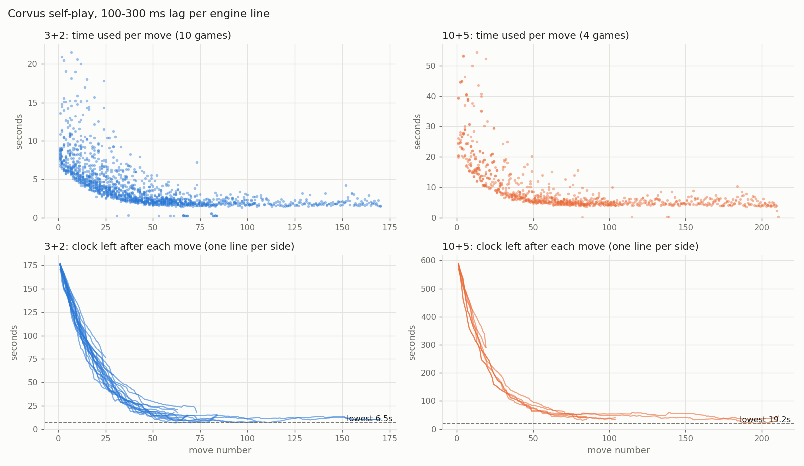

# Corvus pre-competition safety check (2026-10-31)

**Safe to compete: YES.** No way to lose a game for a non-chess reason was found; there are no Critical items.
1. Lag: 14 Corvus-vs-Corvus games (10 × 3+2, 4 × 10+5), 100-300 ms added to every engine line: 0 time losses; lowest clock 6.5 s (3+2) / 19.2 s (10+5).
2. Tricky positions: 19 UCI edge cases × both shipped binaries: every bestmove legal, no hang, stdout pure UCI.
3. Bot config: meets every requirement and equals the template apart from Threads; allow_list still empty (fill it on the day).
4. Engine crash mid-game: lichess-bot restarts Corvus in under 1 s and plays on. One Low risk: a *silent* hang is never restarted, but Corvus has no known hang.

Scope: anything that could lose a game for non-chess reasons (time loss, illegal move, crash, hang, bot config).
Version under test: tag `v-submit-final` (commit d917c39), branch `safety-check`. Binaries were not rebuilt:
`engine/Corvus.exe` sha256 `a2a3c2ac...1d67`, `engine/Corvus-portable.exe` `da4a483b...4ac4`, `engine/corvus.nnue`
`94a27334...60c4` (matches PROGRESS.md). lichess-bot 2026.10.27.3 (commit afa430d) in
`C:\Users\Bhavya\Downloads\lichess-bot-src`, python-chess 1.11.2, backoff 2.2.1.

Nothing in engine source, nets, configs, tags or the live `config.yml` was changed. Lichess was never contacted.
The token was never printed: scripts drop the `token:` key / line on load, and a scan of `audit/safety` for
`lip_...` / `token:` finds nothing.

Load: at most 2 games at a time, Threads 1 per engine (4 search threads), BelowNormal priority for everything.
The offline lichess-bot runs (check 4) used no engine search, only a scripted stub.

Re-run everything: `audit/safety/repro/runall.sh` (Git Bash). `SKIP_LAG=1` skips the ~2 h lag games.

---

## Check 1: network lag: PASS

Method: `repro/lagwrap.cpp` (built to `lagwrap.exe`) sits between fastchess and Corvus. GUI→engine lines pass
straight through; every engine→GUI line is held for a random 100-300 ms (order preserved). Both sides are
wrapped. fastchess, Corvus vs Corvus, `Threads 1`, `Hash 64`, `Move Overhead 150`, openings from
`source/tests/openings_v1.epd` (random, colour-reversed pairs), concurrency 2, no adjudication, BelowNormal.
Commands: `repro/check1_lag.sh 10 180+2 lag-3p2`, `repro/check1_lag.sh 4 600+5 lag-10p5`, then
`python repro/check1_analyze.py logs/check1-lag-chart.png 3+2=logs/lag-3p2.pgn 10+5=logs/lag-10p5.pgn`
(→ `logs/check1-summary.txt`).

| | 3+2 | 10+5 |
|---|---|---|
| games | 10 (8 threefold draws, 2 mates) | 4 (draws: 2 insufficient material, 2 threefold) |
| time losses / illegal / crash / stall | **0** | **0** |
| moves played | 1442 | 837 |
| lowest clock after a move | **6.53 s** (round 3, move 62, white) | **19.19 s** (round 1, move 196, black) |
| longest single move | 21.5 s (move 7) = 12 % of base | 54.3 s (move 13) = 9 % of base |
| lag actually injected per bestmove (`lagwrap` log) | 106-300 ms, median 239 ms | 103-300 ms, median 242 ms |

Chart (`logs/check1-lag-chart.png`): top, time used per move vs move number; bottom, clock left after each
move, one line per side, dashed line at the lowest clock. Corvus spends most in the opening, settles at
about increment + a little, and the clock levels off well above zero; it never relies on the last seconds.



Notes:
- fastchess's own `latency` field (median 0.25 s, but max 16.8 s / 50.8 s) is *measured time minus the
  engine's last `info time`*. Corvus prints `info` once per finished depth, so a long final iteration shows
  up as "latency". The wrapper's own log (`logs/lag-*-bestmove-delays.txt`, one line per bestmove) shows the
  real added delay never exceeded 300 ms.
- The 3+2 run used the first build of `lagwrap`, whose MinGW `std::random_device` gave every wrapper process
  the same seed, so both sides drew the same delay sequence (still 100-300 ms per line). Fixed (seed from
  `random_device` + pid + clock) before the 10+5 run. It does not change the verdict.
- Corvus's own panic mode (< 3 s left) was never reached in these games; check 2 covers it directly
  (`wtime 50`, `wtime 1`).
- Load: 2 games at a time × Threads 1 = at most 4 engine processes, 2 searching at once.

## Check 2: tricky positions: PASS

Method: `repro/check2_tricky.py <exe> --threads 4` starts a **fresh** engine per case with the competition
settings (`Threads 4`, `Hash 256`, `Move Overhead 150`), sends `uci` / `isready` / `ucinewgame` /
`position ...` / `go wtime 3000 btime 3000 winc 2000 binc 2000` (or the case's own `go`), and requires:
exactly one `bestmove` within 5 s, the move legal per python-chess 1.11.2, every stdout line valid UCI,
`isready` still answered afterwards, and a clean exit on `quit`. Every position is self-checked first
(e.g. that en passant really is legal / illegal, that exactly one move exists), and all of them are in
`repro/check2_positions.txt`. Run at BelowNormal, one engine at a time.
Results: `logs/check2-Corvus.{txt,json}`, `logs/check2-Corvus-portable.{txt,json}`. **19/19 clean on both.**

| Case | Position / commands | Corvus.exe | portable |
|---|---|---|---|
| under-promotion (white) | `7b/5Ppk/6pp/3B4/8/8/8/K7 w`; only mate is f8=N | f7f8n | f7f8n |
| under-promotion (black) | colour-flipped | f2f1n | f2f1n |
| Saavedra (rook promotion) | `8/2P5/8/8/3r4/8/2K5/k7 w` | c7c8r | c7c8r |
| legal e.p., the only legal move | `1r5k/1p6/n2b4/P7/K7/7r/8/8 b` + b7b5 | a5b6 | a5b6 |
| legal e.p., normal position | startpos e4 Nf6 e5 d5 | legal | legal |
| e.p. illegal (pinned pawn) | `7k/2p5/8/KP5r/8/8/8/8 b` + c7c5; b5c6 is illegal | b5b6 | b5b6 |
| castling after Rh1-g1-h1 (moves list) | O-O must be illegal | legal, no O-O | legal, no O-O |
| same, as FEN `... w Qkq` | O-O must be illegal | legal, no O-O | legal, no O-O |
| exactly one legal move | `7k/8/5QK1/8/8/8/8/8 b` | h8g8 | h8g8 |
| halfmove clock 99 | `8/8/4k3/8/8/3K4/3R4/8 w - - 99 120` | legal | legal |
| clock reaches 100 through the moves list | same FEN, clock 98 + 2 moves | legal | legal |
| 320-ply moves list | random legal game | legal | legal |
| 1100-ply moves list (> Corvus `MAXGAME` 1024) | quiet game, no 50-move / repetition ending | legal | legal |
| threefold repetition | startpos Nf3 Nf6 Ng1 Ng8 × 2 | legal | legal |
| panic `wtime 50 btime 50 winc 0` | Ruy Lopez after 3...a6 | 0.012 s | 0.012 s |
| panic `wtime 1 ... winc 2000` | same | 0.012 s | 0.012 s |
| `go` (no time params), then `stop` after 1 s | | bestmove right after stop | same |
| `go infinite`, then `stop` | | bestmove right after stop | same |
| lichess-bot's first move: `go movetime 10000` | startpos, 12 s timeout | 9.86 s | ≈ same |

The two binaries chose different (both legal) moves in three cases; multi-threaded searches are not
deterministic, so that is expected. Engine start-up (`uci` → `readyok` with `Hash 256`) took 0.02-0.03 s,
which is the engine part of the crash-restart cost in check 4.

## Check 3: bot config review: PASS (two notes, one reminder)

Command: `python audit/safety/repro/check3_config.py` → `audit/safety/logs/check3.out`.
The live `config.yml` is loaded with `yaml.safe_load`; the `token` key is dropped immediately and token lines
are filtered out of the raw diff.

| Requirement | Live value | Result |
|---|---|---|
| polyglot book | `enabled: false`, `book.standard: []`, `max_depth: 0` | PASS |
| online_moves: chessdb_book, lichess_cloud_analysis, lichess_opening_explorer, online_egtb | all `enabled: false` | PASS |
| syzygy / gaviota | `enabled: false`, `paths: []` | PASS |
| variants / modes | `[standard]` / `[casual]` | PASS |
| time controls | base 180-600 s, inc 2-5 s, speeds blitz + rapid | PASS (accepts 3+2 and 10+5, plus anything in between such as 5+3) |
| matchmaking | `allow_matchmaking: false` | PASS |
| concurrency | `1` (and `max_simultaneous_games_per_user: 1`) | PASS |
| chat | "Good luck and have fun!", "Thanks for the game!", spectators: "Hi! I'm {me}, a competition entry. Enjoy the game!", "Thanks for watching!" | PASS, courteous |
| resign | eval <= -1000 cp for 10 consecutive own moves | PASS, not eager (in 3+2 that is at least 10 moves of being a rook-plus down) |
| draw offers / accepts | \|eval\| <= 10 cp for 10 own moves and <= 12 men left | PASS, not eager; a draw is a replay in the knockout anyway |
| ponder / go_commands / fake think / takebacks | off / none / false / 0 | PASS |
| engine path | `C:/Users/Bhavya/Downloads/chess agent/engine/Corvus.exe`, working_dir the same | PASS |
| **allow_list** | **missing (commented out)** | **REMINDER** for competition day: until it is filled, any Lichess user can challenge, and with concurrency 1 a stranger's game would occupy the only slot when the organisers challenge |

**Live config vs template** (`lichess-bot/config.example.yml`): the only difference is `Threads` (template 15,
live 4), which is an allowed difference. Hash (256) and everything else are identical, including comments.

Notes (not failures):
- **N1, lichess-bot `move_overhead: 2000`.** This is lichess-bot's own setting, separate from Corvus's
  `Move Overhead 150`. lichess-bot subtracts it (plus the time since our opponent's move arrived) from our clock
  before every `go` (`lib/engine_wrapper.py:727`), so Corvus always thinks it has about 2.15 s less than it does.
  This is safe: it only makes Corvus play faster in time trouble. Below about 2 s of real clock, Corvus receives
  `wtime 1` and moves almost instantly (check 2 case `panic_wtime_1_inc`). It costs a little strength in
  scrambles, never a game. Seen in the check 4 log: `go wtime 180000 btime 193937` when the simulated clock was ~195.9 s.
- **N2, the bot plays whatever binary is in the working tree** (`engine.dir` points into this repo). On
  competition day the checkout must be at `v-submit-final` (this `safety-check` branch has the identical
  `engine/` files, so it is safe too), and nothing may rebuild `engine/` while the bot runs. Windows locks a
  running exe, so a rebuild during a game would fail rather than swap the engine.

Host check (read-only `powercfg`): sleep on AC = never, hibernate on AC = never (on battery: 72 h). The lid-close
action could not be read; keep the lid open and the charger in.

## Check 4: engine crash / hang mid-game: crash PASS, hang RISK (Low)

Method: lichess-bot's real game loop (`lib/lichess_bot.py` `play_game`, `lib/engine_wrapper.py`) driven fully
offline by its own mock of lichess.org (`test_bot/lichess.py`). lichess-bot's `test_bot.py` needs pytest,
which is not installed in its venv, and I did not install anything there. So
`audit/safety/repro/check4_runner.py` does what `test_bot.run_bot` does, with our template config (move_overhead
2000 etc.), a 3+2 clock and a 24-ply scripted game (`check4_game.py`, black mates on ply 24). The "engine" is
`stub_engine.py`, a scripted UCI stub that only replays black's moves; it is not a chess engine. It crashes
(`os._exit(3)`) or hangs on its **10th `go`** (ply 19). No account, no token, no network.

Commands (from the lichess-bot folder):
`venv/Scripts/python.exe <repo>/audit/safety/repro/check4_runner.py crash|hang <repo>/audit/safety/logs`

### Engine process dies → lichess-bot restarts it and keeps playing (PASS)

Timeline (`logs/check4-crash-events.txt`, `logs/check4-crash-stub.txt`, full debug log `logs/check4-crash.out`):

```
1793424833.313  stub pid=21276 CRASH on go 10 (ply 19)
                lichess-bot: "Backing off play_game(...) for 0.8s (chess.engine.EngineTerminatedError: engine process died unexpectedly)"
1793424834.131  game stream reopened by lichess-bot (play_game retried)
1793424834.188  stub pid=25556 started            <- new engine process
1793424834.201  bot move f8c5 at ply 19, 0.89 s after the crash; game continued and black mated on ply 24 (bot_won=true)
```

Why, from the code:
- `play_game` is wrapped in `@backoff.on_exception(backoff.expo, BaseException, max_time=600, giveup=lichess.is_final)`
  (`lib/lichess_bot.py:658`). `is_final` (`lib/lichess.py:105`) gives up only on HTTP 4xx or a forced quit, so
  an engine crash is retried.
- python-chess raises `EngineTerminatedError` (a subclass of `EngineError`). `play_move` catches `EngineError`
  but re-raises everything except illegal-move errors (`lib/engine_wrapper.py:189`). The in-game handler only
  catches network errors (`lib/lichess_bot.py:775`), so the exception leaves `play_game`.
- The retry re-enters `play_game`, which reopens the game stream, rebuilds the board from the move list and
  creates a **new** engine (`lib/lichess_bot.py:694`), then plays on.
- Cost: backoff wait (full jitter: 0-1 s on the first retry, 0-2 s on a second, ...) plus engine start-up
  (Corvus `uci` + `setoption Hash 256` + `isready`: 0.02-0.03 s, check 2 `startup_s`), plus the move itself. Corvus loses
  its hash table, nothing else. If Corvus crashed deterministically in the same position it would crash again on
  every retry until the clock ran out; nothing in checks 1-2 suggests such a crash exists.
- Separate path, for completeness: an **illegal** bestmove is not retried. lichess-bot resigns (or aborts
  before move 2) at once (`lib/engine_wrapper.py:189-196`). Check 2 covers bestmove legality.

### Engine alive but silent → lichess-bot waits forever (RISK, Low)

`logs/check4-hang-events.txt`: the stub stopped answering at ply 19. 45 s later there was still no move, no
restart and no backoff (watchdog note), and lichess-bot was still blocked inside `engine.play`. In a real game
this is a loss on time.

Why, from the code:
- Real-time moves send only clock limits: `chess.engine.Limit(white_clock=..., black_clock=..., ...)` with
  `time=None` (`lib/engine_wrapper.py:729`).
- python-chess derives the `play()` timeout from `limit.time` only: `_timeout_for` returns `None` when
  `limit.time is None` (`venv/Lib/site-packages/chess/engine.py:2922-2925`), so there is no timeout.
  The `timeout=60.` passed to `popen_uci` (`lib/engine_wrapper.py:499`) only applies to start-up/handshake commands.
- `should_exit_game`/`terminate_time` (`lib/lichess_bot.py:770-773`, `:922`) are only checked on stream pings,
  which are not processed while the thread is blocked in `play_move` (`lib/lichess_bot.py:745`).
- Only the very first move has a timeout (`go movetime 10000`, `lib/engine_wrapper.py:705` → 10 s + 60 s).

Severity **Low**: this only matters if Corvus itself hangs. Corvus has no known hang. With a clock its search
always stops on its own hard limit (`source/src/timeman.h:43` caps it at 80 % of clock minus overhead; checked
every 1024 nodes, `source/src/search.cpp:78`). It runs untimed only when the side to move gets no clock
(`timeman.h:27`) or on `go infinite` (`search.cpp:439`). lichess-bot never sends either: it floors the clock at
1 ms (`lib/engine_wrapper.py:727`). Checks 1 and 2 found no hang. Fix only
after the competition (see below); a change to lichess-bot now would be untested.

---

## Recommended before Nov 3

**Critical items: none.** Nothing needs to change in Corvus, the net or the bot config.

Competition-day checklist (operational reminders, not bugs):
1. Fill `challenge.allow_list` in `config.yml` with the organisers' / opponents' accounts, so a stranger
   cannot take the single game slot (concurrency 1).
2. Run the bot from a checkout of `v-submit-final` (or this branch, which has identical `engine/` files);
   do not rebuild `engine/` while the bot is running (N2).
3. Laptop on the charger, lid open, nothing else heavy running; AC sleep/hibernate are already "never".
4. Run exactly one lichess-bot instance.

## After the competition

1. **Hang watchdog in lichess-bot** (check 4, Low). Root cause: `lib/engine_wrapper.py:729` sends a
   clock-only `Limit`, so python-chess applies no timeout (`chess/engine.py:2922-2925`) and
   `play_move` (`lib/lichess_bot.py:745`) can block forever. Smallest safe fix: bound the `engine.play` call
   by our remaining clock plus a margin (e.g. run it with a timeout and, on expiry, kill the engine process).
   The resulting `EngineTerminatedError` already goes through the tested backoff → restart path.
   Must be tested offline (check 4's runner) before use, which is why it is not recommended now.
2. **Optional: lower lichess-bot `move_overhead` 2000 → ~1000 ms** (check 3, N1). Not a safety issue; it
   would only give Corvus a little more time in scrambles. Check 1 showed ample clock margin even with lag.
3. Housekeeping: lichess-bot's venv has no pytest, so its own `test_bot.py` cannot run there.
